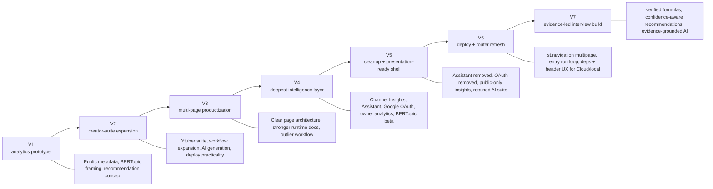
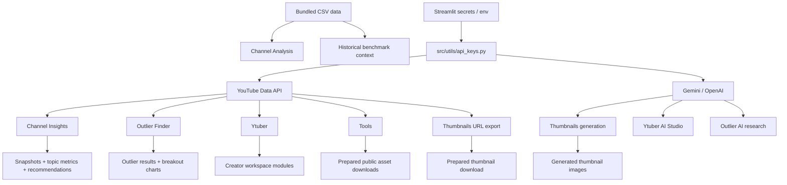
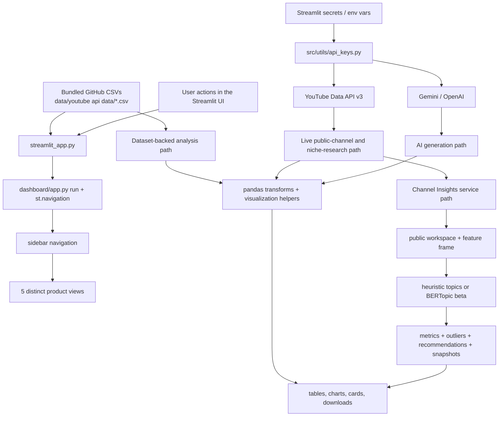
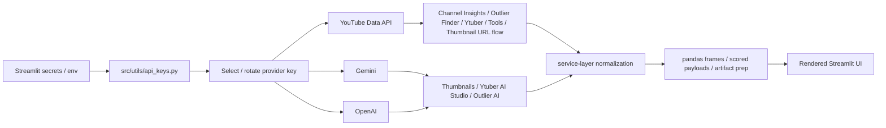
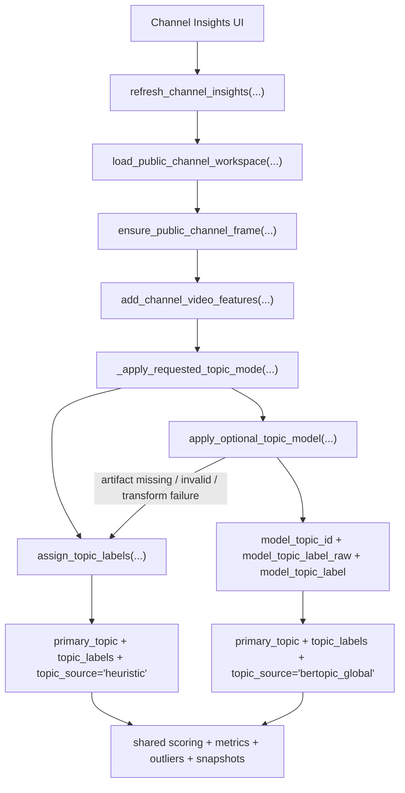
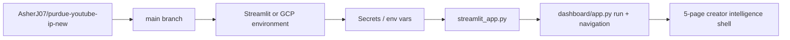

# YouTube Creator Insights — Evidence-led Creator Decisions

YouTube Creator Insights is a public-data decision product for small and mid-sized YouTube creators. The current interview build connects trustworthy analytics, channel-level recommendations, creator tools, and evidence-grounded AI workflows without hiding uncertainty or inventing private metrics.

**Live app (V7):**

- **[youtube-ip-v7.streamlit.app](https://youtube-ip-v7.streamlit.app/)**

Earlier V5 deployment (historical): [youtube-ip-v5.streamlit.app](https://youtube-ip-v5.streamlit.app/)

Quick jump:

| If you want to understand... | Start here |
| --- | --- |
| current runtime and page flows | [Architecture](docs/ARCHITECTURE.md) |
| deployment targets, secrets, and version mapping | [Deployment And Versions](docs/DEPLOYMENT_AND_VERSIONS.md) |
| the full project story from V1 through V7 | [Project Brief](docs/PROJECT_BRIEF.md) |
| every active formula and its limitations | [Metrics and Decision Logic](maths.md) |
| a GCP-friendly env template | [`.env.gcp.example`](.env.gcp.example) |

## At A Glance

| Metric | Current Count / State |
| --- | --- |
| Deployed versions documented here | `7` (`V1`–`V7`) |
| Live Streamlit app links (including historical) | `7` |
| Current sidebar destinations | `5` |
| Current primary data paths | `2` |
| Current Channel Insights topic modes | `2` |
| Required live provider family | `1` (`YouTube`) |
| Optional model-artifact path | `1` (`BERTopic` beta) |

## Current Product In One Minute

- `Benchmarks` uses the committed research datasets and robust, documented public metrics.
- `Channel Insights` analyzes one public channel, shows confidence and supporting sample sizes, and proposes controlled creator experiments.
- `Download Hub` turns analysis into usable thumbnail and media assets.
- `Outlier Finder` compares channel-relative reach, age-cohort reach, public interaction, and evidence reliability, then offers optional evidence-grounded AI synthesis.
- `Ytuber` provides a broader creator workspace for search, audits, planning, title work, and AI-assisted creation.
- Heuristic topics are always available; BERTopic remains an optional, confidence-aware model path that can abstain.
- Generative AI does not automatically manufacture recommendations. The default decision layer is deterministic and evidence-backed.
- Every active formula, invalid case, and interpretation limit is documented in [`maths.md`](maths.md).

## Why This Project Exists

The original goal of the project was simple: help small-to-mid-sized YouTube creators make better content decisions with better intelligence than YouTube Studio alone provides. The early versions focused on public metadata, cross-channel benchmarking, semantic topic modeling, and AI-assisted recommendations so the team could answer questions like:

- What content themes actually perform across comparable channels?
- Which topics, formats, and publishing patterns correlate with stronger performance?
- How can a creator move from raw channel data to a usable action plan for titles, thumbnails, and next videos?

That core question stayed constant across every version. What changed was the way the app packaged the answer.

## Version Lineage (V1–V7)

Short history before the deeper tables below.



## Deployed Version History

| Version | Live App | Main Goal | Headline Additions | Major Simplifications / Later Changes | Status |
| --- | --- | --- | --- | --- | --- |
| `V1` | [youtube-stats-ip.streamlit.app](https://youtube-stats-ip.streamlit.app/) | prove the analytics + recommendation concept | public YouTube analytics framing, BERTopic modeling direction, initial Streamlit dashboard, thumbnail dashboard | later versions expanded beyond the original compact dashboard | historical prototype |
| `V2` | [youtube-stats-ip-v2.streamlit.app](https://youtube-stats-ip-v2.streamlit.app/) | expand into a creator operating system | creator workflow framing, richer app shell, advanced Ytuber suite, deploy guidance | some modules were later split, simplified, or removed for maintainability | historical expansion |
| `V3` | [youtube-ip-v3.streamlit.app](https://youtube-ip-v3.streamlit.app/) | turn the project into a clearer product | five-page product shell, strong runtime architecture, outlier workflow, better repo map | later versions added deeper insights and then simplified again | historical productization |
| `V4` | [youtube-ip-v4.streamlit.app](https://youtube-ip-v4.streamlit.app/) | deepen intelligence and tracked-channel analysis | Channel Insights, sidebar Assistant, Google OAuth owner analytics, optional BERTopic beta | V5 removed the Assistant and Google OAuth to reduce deployment complexity | historical deep-intelligence release |
| `V5` | [youtube-ip-v5.streamlit.app](https://youtube-ip-v5.streamlit.app/) | keep the best parts and document the journey | public-only Channel Insights, retained AI suite pages, Thumbnails rename, consolidated docs, optional BERTopic beta | lighter than V4, easier to reason about, presentation-ready documentation | historical release |
| `V6` | [ip-youtube-creator-insight-2026.streamlit.app](https://ip-youtube-creator-insight-2026.streamlit.app/) | ship a dependable Cloud + local runtime on top of V5 | Streamlit `st.navigation` router, `streamlit_app` → `run()` entry, explicit PyArrow / Google client deps, sidebar + hero layout fixes | product scope matches V5; focus is operational reliability | historical release |
| `V7` | [youtube-ip-v7.streamlit.app](https://youtube-ip-v7.streamlit.app/) | turn analysis into defensible creator decisions | canonical public-metric formulas, visible confidence and sample sizes, BERTopic abstention, evidence-grounded AI synthesis | removes unsupported AI claims while retaining distinct creator workflows | **current release** |

## What Changed Across Versions

| Area | V1 | V2 | V3 | V4 | V5 | V6 |
| --- | --- | --- | --- | --- | --- | --- |
| Core problem | creator strategy from public data | same | same | same | same | same |
| Bundled dataset benchmarking | present | present | strong | present | present | present |
| Creator workspace | early | expanded heavily | strong | present | present | present |
| Outlier research | emerging | present in suite | strong standalone page | strong | strong | strong |
| Thumbnail generation | present | expanded | present | present | present | present |
| Channel Insights tracked snapshots | absent | absent | absent | added | retained | retained |
| Sidebar Assistant | absent | absent | absent | added | removed | removed |
| Google OAuth / owner analytics | absent | absent | absent | added | removed | removed |
| Optional BERTopic model path | conceptual | conceptual | documented stack direction | added to runtime | retained | retained |
| Presentation-quality consolidated docs | basic | practical | stronger | strong | strongest | strongest |
| Streamlit multipage router (`st.navigation`) | — | — | — | — | custom / evolving | **built-in** |

## What Survived Into V6

- Public-data-first creator intelligence stayed central from V1 onward.
- Bundled CSV benchmarking survived as `Channel Analysis`.
- Live public-channel analysis survived and matured into `Channel Insights`.
- AI-assisted creative generation survived through `Thumbnails` and `Ytuber`.
- Outlier research survived and remains a distinct workflow.
- Optional BERTopic topic modeling survived, but as a guarded beta path rather than a required dependency.
- Streamlit deployment remained the delivery surface for every released version.

## What We Tried And Later Removed Or Simplified

| Capability | Highest-Version Form | Why It Was Valuable | Why It Was Reduced Or Removed In V5 / Unchanged In V6 |
| --- | --- | --- | --- |
| Sidebar `Assistant` | V4 | gave global help and retrieval-driven guidance across pages | added surface area, more maintenance, and more cognitive load than the lighter shell needed; still absent in V6 |
| Google OAuth + owner analytics overlay | V4 | enabled private metrics such as impressions, CTR, watch time, and retention | raised deploy complexity, secrets burden, and public-vs-owner workflow branching; still absent in V6 |
| Heavier mixed recommendation UI | V3 / V4 | combined strategy guidance with creative tooling | overlapped with `Channel Analysis` and `Channel Insights`; V5 narrows page 3 to `Thumbnails` (unchanged in V6) |
| Broader “everything page” behavior in earlier suites | V2 | useful during exploration and experimentation | harder to document and reason about than clearly separated workflows |
| Always-growing feature surface | V2-V4 | helped the team test many ideas quickly | eventually created duplication, deployment weight, and documentation drift |

## Current Product Surface

The current sidebar order is:

1. `Channel Analysis`
2. `Channel Insights`
3. `Download Hub`
4. `Outlier Finder`
5. `Ytuber`

This is the high-level page map. The detailed runtime handoffs for each page live in [Architecture](docs/ARCHITECTURE.md).

| Page | What Problem It Solves | Main Inputs | Main Outputs | Runtime Type |
| --- | --- | --- | --- | --- |
| `Channel Analysis` | benchmark bundled datasets and compare portfolio-level performance | committed CSV data in `data/youtube api data/` | KPI cards, trend charts, channel/video rankings | dataset-backed |
| `Channel Insights` | convert one tracked public channel into a supported experiment | YouTube public data, snapshot history, optional BERTopic | evidence, confidence, supporting samples, next tests | mixed |
| `Download Hub` | move from insights to creative assets and exports | video URLs, prompts, configured AI providers | thumbnails and public media artifacts | mixed |
| `Outlier Finder` | find unusual performance in a niche | live YouTube API scan and explainable scoring | ranked evidence, score decomposition, optional AI synthesis | mixed |
| `Ytuber` | support the broader creator workflow | live YouTube data, user inputs, configured AI providers | audits, title ideas, plans, and creator experiments | mixed |

## Current V7 Workflow Map

This section is about the live app today, not the historical versions.

| Page | User Goal | Main Inputs | Main Services Used | Main Outputs | Runtime Type |
| --- | --- | --- | --- | --- | --- |
| `Channel Analysis` | compare bundled channel/video benchmarks | committed CSV files, filters, date ranges | pandas transforms, visualization helpers | KPI cards, monthly trends, top channels, top videos | dataset-backed |
| `Channel Insights` | choose one evidence-backed creator experiment | channel URL/handle/ID, topic mode, snapshot refresh | `public_channel_service`, `channel_insights_service`, `channel_snapshot_store`, `topic_model_runtime` | overview, evidence tables, outliers, history | mixed |
| `Download Hub` | generate or collect usable creator assets | prompts, public URLs, provider configuration | thumbnail and download services | generated and prepared assets | mixed |
| `Outlier Finder` | surface unusual videos in a niche | niche query and explicit filters | `outliers_finder.py`, canonical metric helpers, optional AI provider | ranked results, evidence quality, structured synthesis | mixed |
| `Ytuber` | work across research, planning, and creation | public channel inputs and provider configuration | YouTube and AI provider services | audits, plans, title tests, creative assistance | mixed |



In practice, V7 works as three layers:

- `Data`: bundled CSV benchmarking plus live provider/API calls
- `Service`: normalization, scoring, topic assignment, artifact prep
- `UI`: Streamlit cards, charts, tabs, downloads, and guided workflows

For the full section-by-section mechanics, see [Architecture](docs/ARCHITECTURE.md).

## Current Interactive Surfaces

These are the main interactive surfaces a user actually navigates once a page is open.

| Page | Surface Type | Count | Current Surfaces | What They Do |
| --- | --- | --- | --- | --- |
| `Channel Analysis` | main analytics canvas | `1` | dataset filters + charts/tables | benchmark bundled CSV data |
| `Channel Insights` | tabs | `6` | `Overview`, `Topic Trends`, `Formats & Patterns`, `Outliers`, `Next Topics`, `History` | move from a tracked snapshot to a supported experiment without burying the evidence |
| `Download Hub` | tool tabs | `2` | thumbnails, public media downloads | prepare assets without mixing them into analytics pages |
| `Outlier Finder` | post-search sections | `5` | results, breakout snapshot, repeated evidence, optional AI synthesis, methodology | inspect unusual performance before acting on it |
| `Ytuber` | creator modules | multiple | search, audits, planning, titles, benchmarks, AI Studio | support the end-to-end creator workflow |

For the detailed tab-by-tab and module-by-module behavior, see:

- [Architecture: Channel Insights](docs/ARCHITECTURE.md#channel-insights)
- [Architecture: Thumbnails](docs/ARCHITECTURE.md#thumbnails)
- [Architecture: Outlier Finder](docs/ARCHITECTURE.md#outlier-finder)
- [Architecture: Ytuber](docs/ARCHITECTURE.md#ytuber)
- [Architecture: Tools](docs/ARCHITECTURE.md#tools)

## Current V7 Architecture In One View



The architecture resolves into three repeatable patterns:

- `Dataset path`: GitHub CSVs -> pandas transforms -> benchmark visuals
- `Live API path`: secrets/env -> provider clients -> normalized payloads -> interactive pages
- `Model path`: Channel Insights feature frame -> heuristic or BERTopic topics -> downstream metrics and recommendations

For the deeper page-by-page breakdown, see [Architecture](docs/ARCHITECTURE.md#page-problem-map).

## API And Secrets Flow



This is the live V7 runtime path today:

- bundled CSVs power `Channel Analysis`
- live YouTube API calls power `Channel Insights`, `Outlier Finder`, `Ytuber`, `Tools`, and thumbnail URL export
- Gemini/OpenAI power thumbnail generation, AI Studio, and Outlier AI research
- the same secret names work in Streamlit secrets or GCP-style injected environment variables

For the deeper API/service explanation, see [Architecture](docs/ARCHITECTURE.md#api-data-pipeline-overview).

## Channel Insights: Where The Modeling Actually Lives

`Channel Insights` is where the most advanced modeling work lands in V7. Every refresh starts with the same public-channel workspace, then branches into one of two topic assignment modes:

- `Heuristic Topics`
  - default mode
  - built from title, tags, and description tokenization
  - always available
- `Model-Backed Topics (Beta)`
  - optional BERTopic semantic grouping
  - activated only when beta mode is selected and the model manifest/artifact path is configured
  - falls back to heuristics if anything fails



For the full topic-mode branch, tab flow, and artifact-state details, see [Architecture: Channel Insights](docs/ARCHITECTURE.md#channel-insights).

## Deployment Summary

| Item | Value |
| --- | --- |
| Original repo | `matt-foor/purdue-youtube-ip` |
| Current deploy repo | `AsherJ07/purdue-youtube-ip-new` |
| Current deploy branch | `main` |
| V6 historical branch | `youtube-ip-v6` |
| V5 historical branch | `youtube-ip-v5` |
| Public V7 live app | [youtube-ip-v7.streamlit.app](https://youtube-ip-v7.streamlit.app/) |
| Earlier documented deploy (V5) | `royayushkr/Youtube-IP-V5` on `main` (see [Deployment And Versions](docs/DEPLOYMENT_AND_VERSIONS.md)) |
| Main file path (Streamlit Cloud) | `streamlit_app.py` |
| Required secret family | `YOUTUBE` for live analysis; bundled benchmarks work without it |
| Optional secret family | `MODEL_ARTIFACTS_*` for BERTopic beta |



Deployment notes in one screen:

- V7 stays **public-only** for `Channel Insights`
- the app reads `st.secrets` first, then environment variables
- BERTopic beta only activates when `MODEL_ARTIFACTS_ENABLED=true` and the manifest URL is configured
- the GCP-oriented env template is [`.env.gcp.example`](.env.gcp.example), which is meant to be copied into Cloud Run, GCE, or Secret Manager-backed environment configuration rather than committed as a real secret file

For the full deployment matrix and secrets history, see [Deployment And Versions](docs/DEPLOYMENT_AND_VERSIONS.md).

## Project Brief And Evolution Summary

The short version of the project story is:

- `V1` proved the public-data analytics and recommendation concept
- `V2` expanded into a broader creator operating system
- `V3` clarified the product shell and runtime structure
- `V4` added the deepest intelligence layer with `Channel Insights`, Assistant, Google OAuth, and BERTopic beta
- `V5` kept the strongest workflows, removed the heaviest operational complexity, and documented the system clearly for presentation and deployment
- `V6` hardened the router, dependencies, and deployment path
- `V7` is the **current** Streamlit release: a focused, evidence-led decision product with verified formulas and confidence-aware topic recommendations ([live app](https://youtube-ip-v7.streamlit.app/))

What V5 removed on purpose (still true in V6):

- sidebar `Assistant`
- Google OAuth and owner-only analytics overlays
- heavier mixed recommendation behavior on page 3

What V5 kept on purpose (still true in V6):

- dataset benchmarking
- public tracked-channel insights
- thumbnail generation and export
- outlier research
- the live `Ytuber` workspace
- optional BERTopic beta modeling

What V6 adds on top of V5:

- dependable **local and Cloud** runs (correct Python wheels, PyArrow, Google client stack)
- **Streamlit-native multipage** navigation and a single **`run()`** entry from `streamlit_app.py` so every rerun executes the router

For the full narrative brief and retrospective, see [Project Brief](docs/PROJECT_BRIEF.md).

## Where To Read Next

- [Architecture](docs/ARCHITECTURE.md) for the full runtime pipeline, page map, and topic-model integration details
- [Deployment And Versions](docs/DEPLOYMENT_AND_VERSIONS.md) for branch targets, secrets evolution, and version/deployment comparisons
- [Project Brief](docs/PROJECT_BRIEF.md) for the narrative project story, original goals, and evolution through V7

## Ethics And Operating Principles

The original V1 principles still apply in V7:

- use public data responsibly
- respect provider terms of service
- avoid exposing personal data
- prefer explainable insights over black-box claims
- make AI-generated outputs additive to analysis, not a replacement for it

## Local Run

```bash
python3 -m venv .venv
source .venv/bin/activate
pip install -r requirements.txt
streamlit run streamlit_app.py
```
